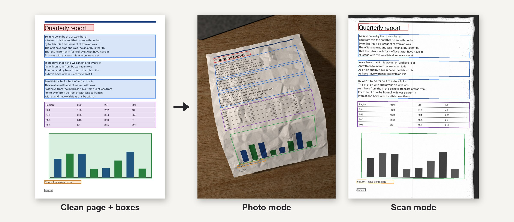
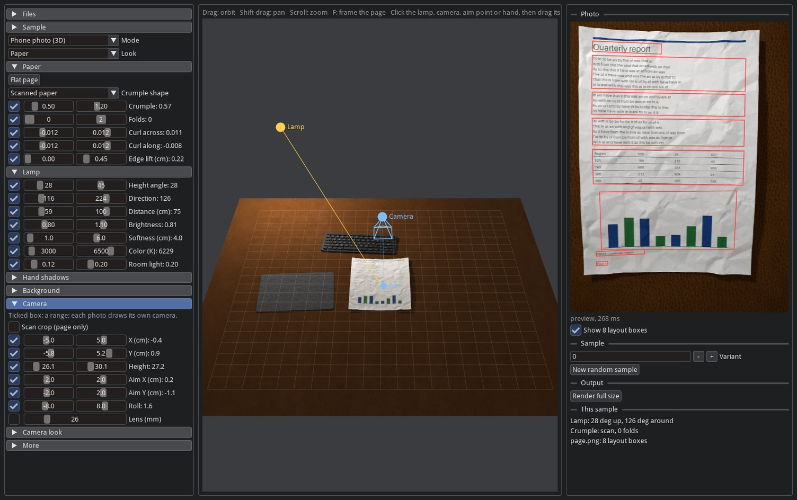

# Recapture

[](https://github.com/PSPDFKit-labs/recapture/actions/workflows/tests.yml)
[](pyproject.toml)
[](https://docs.astral.sh/uv/)
[](LICENSE)
[](#install)



Recapture turns clean document images into realistic phone photos and scans. It moves each page's layout boxes into every new image, so the output is ready-made training data for layout detection.

- **Photo mode** crumples the page as a 3D mesh, puts it on a desk, lights it and photographs it with a virtual phone.
- **Scan mode** adds printer marks and runs the page through a virtual flatbed scanner.

[GLOSSARY.md](GLOSSARY.md) defines the project's terms. Design notes and the reasons behind key choices live in [docs/design.md](docs/design.md). [AGENTS.md](AGENTS.md) is the guide for coding agents that work on the repo.

## Quick start

```bash
recapture init my.json --from mix
recapture edit my.json --doc docs/page.png
recapture preview my.json -i docs/ -n 6
recapture render -i docs/ -c my.json -o dataset/
recapture export dataset/ -o export/ --format coco
```

1. `init` writes a config to start from. `mix` makes 70 % photos and 30 % scans; `card` makes a laminated plastic card (ID or bank card).
2. `edit` opens that config in the [editor](#editor) on one of your pages. Move the sliders until the images look right, then save.
3. `preview` renders 6 samples onto `preview.jpg`.
4. `render` makes the dataset, and `export` writes it as COCO.

The editor needs the `editor` extra. Without it, edit the JSON by hand: `recapture defaults` lists every key.

## Install

You need [git](https://git-scm.com) and [uv](https://docs.astral.sh/uv/). uv brings its own Python 3.12. Recapture is tested on macOS and Linux. Windows is untested.

<details>
<summary><b>Local install</b>: clone the repo and run the steps yourself</summary>

```bash
git clone https://github.com/PSPDFKit-labs/recapture.git
cd recapture
uv venv .venv --python 3.12
uv pip install --python .venv/bin/python -e '.[dev,editor]'
.venv/bin/recapture fetch-assets
```

- `fetch-assets` downloads about 105 MB of CC0 textures from Poly Haven and ambientCG into `assets/` and keeps 85 MB. It asks first and skips files it already has.
- `editor` adds the editor window, about 30 MB. Leave it out on a server.
- `dev` adds pytest.

To use plain `recapture` in any terminal, add the clone as a uv tool:

```bash
uv tool install --editable '.[editor]'
```

</details>

<details>
<summary><b>Agentic install</b>: let your coding agent set it up and make datasets</summary>

The repo is also a Claude Code plugin with a `recapture` skill. On first use the skill installs the CLI with `uv tool install`, asks before downloading the assets, then walks the agent through config, preview, render and export.

**Claude Code**

```text
/plugin marketplace add PSPDFKit-labs/recapture
/plugin install recapture@recapture
```

Then ask something like "Degrade the pages in `docs/`, 30 % scans, COCO export."

- Update with `claude plugin update recapture@recapture`, or turn on auto-update under `/plugin`, Marketplaces.
**Codex, pi and other agents**

They read the same skill format, the [Agent Skills](https://agentskills.io) standard. Clone the repo and make `skills/recapture/` visible to the agent. For pi, link it into `~/.agents/skills/`:

```bash
ln -s "$PWD/skills/recapture" ~/.agents/skills/recapture
```

For Codex, use the skills folder its docs name.

**Any agent, without the skill**

Paste this prompt:

```text
Install the Recapture CLI (https://github.com/PSPDFKit-labs/recapture):
1. If uv is missing, ask me before installing it (https://docs.astral.sh/uv/).
2. Run: uv tool install 'recapture[editor] @ git+https://github.com/PSPDFKit-labs/recapture.git@v0.1.0'
3. Check that `recapture --version` works in a new shell; if not, run `uv tool update-shell`.
4. Ask me before the download (about 105 MB of CC0 assets), then run `recapture fetch-assets --yes`.
5. Make a test: `recapture init test.json --from mix`, then
   `recapture preview test.json -i <a folder with a page image> -n 4`, and show me preview.jpg.
6. Read the "Make a dataset" section of https://github.com/PSPDFKit-labs/recapture/blob/main/README.md
   and tell me in a few lines how to make a dataset (init, preview, render, export).
Stop and tell me if a step fails; do not work around errors on your own.
```

An installed CLI keeps its assets in `~/.cache/recapture/assets`.

</details>

## Make a dataset

1. **`init`** writes a complete config from an example. Pick `photo`, `scan`, `mix`, which makes 30 % scans, or `card`, a glossy plastic card with rounded corners. The file is yours. Library updates never change it.
2. **`edit`** opens the config in the editor on one of your pages. Sliders change the look; a ticked box turns a value into a random range. Save, and the next steps use it.
3. **`preview`** renders a few images onto `preview.jpg` with the label quads drawn, and prints what it made. Check it before a long run.
4. **`render`** makes the dataset. Each image draws its own random settings, so one page gives as many different images as you ask for.
5. **`export`** writes COCO or YOLO-OBB. All variants of one page land in the same split, so the model never sees near-copies of its test pages.

`render` flags:

| Flag | Meaning |
|---|---|
| `-i` | an image or a folder of images |
| `-c` | the config file |
| `-o` | the output folder |
| `-n` | images per page, default 1 |
| `-j` | worker processes; a photo worker needs about 1.6 GB of memory |
| `--seed` | base seed, default the config's `seed` |
| `--format jpg\|png` | override `output.format` |
| `--recursive` | look in sub-folders too; `doc_a/page.png` and `doc_b/page.png` get different photos |
| `--skip-existing` | continue a stopped run |

`export` takes `--format coco|yolo-obb`, `--val` and `--test` as shares of the pages, and `--classes` to fix the class order. A split needs at least one whole page, so with 10 pages `--val 0.1` gives about one.

Other commands:

```bash
recapture edit my.json        # the editor window
recapture validate my.json    # check a config
recapture defaults            # every config key, with what it does
recapture sample my.json      # print one set of drawn values
recapture fetch-assets        # download the assets
```

## Inputs

Put a JSON file next to each page image with the same name, `invoice.png` and `invoice.json`. A page without one still renders, with no labels. Coordinates are pixels of that image, from the top-left corner.

The simple format:

```json
{"boxes": [
  {"id": "p1", "label": "paragraph", "bbox": [120, 340, 980, 610]},
  {"id": "f1", "label": "figure", "quad": [[100, 700], [900, 700], [900, 1200], [100, 1200]]}
]}
```

A box needs `bbox` or `quad`. Other keys, such as `text`, are copied to the output.

A response from the parse endpoint of Nutrient's [DWS Data Extraction API](https://www.nutrient.io/guides/dws-data-extraction/parsing/) also works as it is. Recapture reads its `output.elements`:

- `points` or `bounds` give the box. When both exist, `points` wins.
- `role`, or else `type`, gives the label.
- `type`, `role`, `text`, `readingOrder` and `confidence` are copied.
- Coordinates scale to the image when the element's `page` size differs.

One file holds one page.

## Outputs

Each image gets three files:

| File | What it holds |
|---|---|
| `invoice_000.jpg` | the photo or scan |
| `invoice_000.json` | the labels |
| `invoice_000.config.json` | every value this image drew, and the `recapture_version` |

Each box in the label file has:

| Field | Meaning |
|---|---|
| `quad` | the smallest 4-point shape around the visible part of the box, clockwise from the corner nearest its top-left; `null` when none of it shows |
| `corners` | the box's 4 source corners, projected into the image |
| `visible` | the share of the box the camera sees, 0 to 1 |
| `truncated` | `true` when part of the box is outside the frame |

The file also has `source`, `image`, `size` and `page_corners`. On a flat page, `quad` and `corners` match. They differ when the page bends or a fold hides part of the box.

Every pixel whose center shows a box lies inside its `quad`. At an edge seen almost side-on, a partly covered pixel can sit up to 1 px outside. The tests check this on random flat and deformed pages.

## Config

Any value can be a random range, drawn again for each image:

```json
{"uniform": [30, 60]}
{"randint": [80, 95]}
{"normal": [45, 5], "clip": [30, 60]}
{"choice": ["a", "b"], "weights": [0.7, 0.3]}
{"repeat": {"randint": [0, 2]}, "item": {"angle_deg": {"uniform": [-25, 25]}}}
```

- `repeat` makes a list, such as `deform.folds`, where each item draws its own values.
- Each value has its own random stream. Changing one range leaves every other drawn value alone.
- The same config, seed and version always give the same images.
- Units are centimeters and degrees.

`recapture defaults` lists every key. The ones that change the look most:

| Key | Effect |
|---|---|
| `mode` | `"photo"`, `"scan"`, or `{"choice": ["photo", "scan"], "weights": [0.7, 0.3]}` for both |
| `deform.crumple.strength` | 0 flat, 1 a normal crumple, 2 heavy |
| `deform.crumple.scan.tile_cm` | crease size; smaller gives sharper creases |
| `light.elevation_deg` | 12 to 30 rakes across the page and shows the crumple; 60 and up hides it |
| `light.ambient` | room light; keep it near 0.08 to 0.18 so crease shadows stay dark |
| `desk.items` | keyboard, mousepad, phone, mug, pen, pencil, sticky notes, paper |
| `fx.quality` | 1 a good camera, 0 a cheap phone |
| `crop.enabled` | crop to the page like a scanner app |

### Asset paths

`"@assets/polyhaven/desks"` points into the asset folder. That folder is `$RECAPTURE_ASSETS` when set, `assets/` in a clone, and `~/.cache/recapture/assets` otherwise. Any other relative path is relative to the config file. Use `@assets/` in configs you share, so they work on any machine.

## Photo mode

- **Page.** A 3D mesh with crumple from scanned paper height maps, folds, curl and lifted edges.
- **Desk.** One of 35 surfaces: woods, plain laminates, marble, linoleum, leather pads and tablecloths. Items lie beside the page, cast shadows and never cover it.
- **Lamp.** One lamp casts every shadow, including optional hand and phone shadows.
- **Camera.** A phone camera with focus blur, noise, sharpening, vignette and JPEG, plus `fx.quality` for cheap phones.
- **Background off.** `background.enabled: false` gives a PNG that is transparent around the page.

Photos need OpenGL. A Mac or a desktop works. A Linux server needs EGL.

## Scan mode

The page goes through a printer, then a scanner. Every effect is off at 0.

| Step | Keys |
|---|---|
| Printer | `ink_bleed`, `broken_strokes` (low toner), `ghost` (double strike), `toner_streaks`, `toner_specks` |
| Scanner | `dpi` (sets the output size), `skew_deg`, `blur_px`, `bold`, `noise`, `streaks`, `dust`, `dark_edges` and `edge_dots` (scanner lid showing past the paper), `color` (`color`, `gray` or `bw`), `bw_threshold` |

The skew and the resize are one matrix, so labels stay exact. Scans need no GPU. See `configs/scan.json`.

## Editor

The editor is where you build configs. Open one of your pages, move the sliders until the photo or scan looks right, and save. `render` then uses that config for the whole dataset.

Tick the box before a slider and the value becomes a range. Each image then draws its own value from that range. Wide ranges give a dataset with many desks, lamps, camera angles and paper states. Narrow ones give a single look, such as cheap-phone photos under a desk lamp or gray office scans.



```bash
recapture edit my.json --doc page.png
```

- **Left.** Sliders for the paper, lamp, hand shadows, background, camera and camera look. The box before a slider turns it into a random range. In scan mode, the printer and scanner sliders show instead. The Look menu turns a photo config into a plastic card and back: it sets the card size, stops the crumple and folds, and shows the Card sliders.
- **Center.** The 3D scene. Drag to orbit, Shift-drag to pan, scroll to zoom, F to fit. Click the lamp, the camera, its aim point or a hand, then drag its arrows.
- **Right.** The image the camera takes, with the label quads, updated as you drag. Render it full size and save it.

Variant *n* in the editor is the same image `recapture render` makes as variant *n*. Saved configs hold only what differs from the defaults.

## Use from Python

The CLI is a thin layer over the library. These names are the public API:

```python
from pathlib import Path
from recapture import Job, Pipeline, fetch_assets, job_seed, load_config

fetch_assets()  # once; skips files you already have
pipe = Pipeline(load_config("my.json"))  # or build_config({...}) for a dict
for v in range(3):
    job = Job(source=Path("in/page.png"), out_dir=Path("out"), variant=v,
              seed=job_seed(7, "page.png", v))
    result = pipe.run(job)
    print(result.image_path, len(result.labels["boxes"]))
```

- `run` writes the same three files as `recapture render` and returns them as a `JobResult`.
- `job_seed(seed, path inside the input folder, variant)` gives the seed the CLI uses, so both make the same images.
- Photo mode makes an OpenGL context on the first photo job. Scan mode needs none.
- Use one `Pipeline` per process. For parallel work, start one per worker process, as `--workers` does.
- Other modules can change between versions. `recapture.__all__` lists the stable names.

## Tests

```bash
.venv/bin/pytest
```

## License

Recapture is open source under the [Apache License 2.0](LICENSE). See [NOTICE](NOTICE) for third-party credits.
